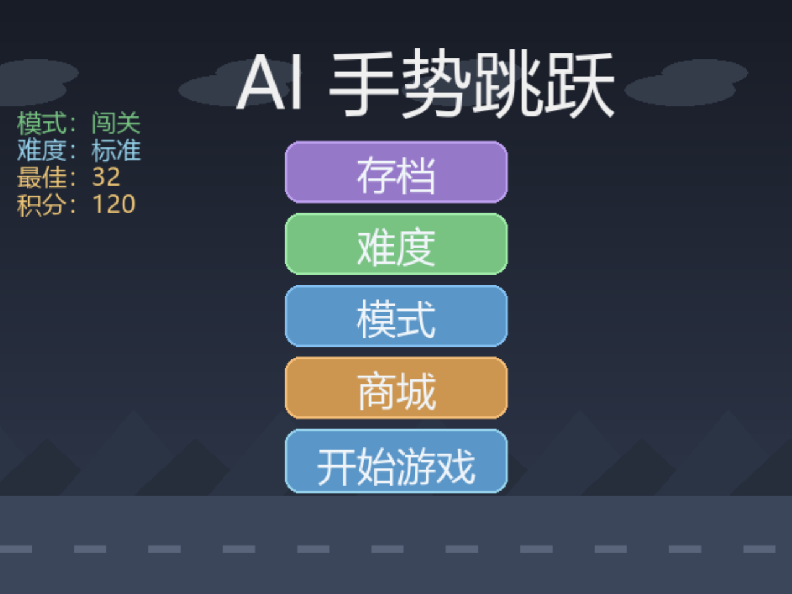
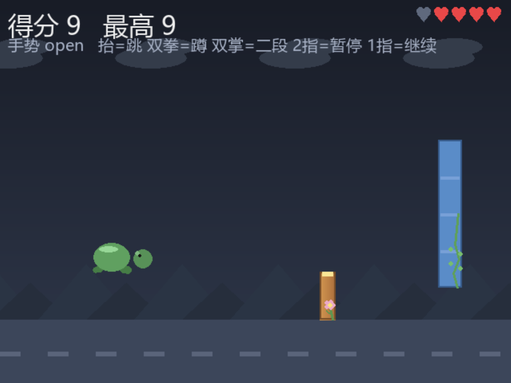

# AI 手势跳跃 · AI Gesture Jump

> 对着摄像头抬手、握拳、张开双掌，操控一只小乌龟跳过柱子、蹲过矮墙、登上窄桥、冲向终点旗 —— 一个**完全不用键鼠**的体感横版平台游戏。

**技术栈**：Python 3.12 · MediaPipe Hand Landmarker（21 关键点 / 免训练）· OpenCV · Pygame 2.6 · NumPy
**代码规模**：约 1,450 行 Python（游戏主体 + 识别封装）+ 8 个程序化音效 / 1 段 BGM
**运行方式**：单机桌面程序，逻辑分辨率 640×480，全屏自适应放大，60 FPS 主循环

| 主菜单 | 对局 |
|:--:|:--:|
|  |  |

---

## 一、它是什么

一个把**实时手部姿态识别**接到**完整可玩的平台跳跃游戏**里的作品：

- 打开程序后，摄像头识别你的手；
- 做出不同手势，角色即时跳跃 / 下蹲 / 二段跳 / 暂停；
- 一关包含 3 根柱子、2 道蹲墙、2.5 屏窄桥（红凸块 + 半高柱 + 三连红）、终点旗；
- 有生命值、计分、最高分、10 个存档槽、积分商城与 5 款皮肤。

与传统键鼠游戏相比，这里没有"按键映射"，只有**姿态 → 指令**的一层规则引擎；而让这件小事变难的，不是识别本身，而是**抖动、误触发、手部跟丢**这些真实世界里的噪声。

---

## 二、手势 → 操作

| 手势 | 动作 | 识别规则 |
|------|------|----------|
| 单手掌张开（≥3 指伸直） | **跳跃** | 4 指中 ≥3 指"指尖离手腕 > 指根关节离手腕" |
| 双拳 | **下蹲 / 站起**（切换） | 两只手都判定为 fist；连续 2 帧进入、松开 8 帧后重新武装 |
| 双掌张开（离地后） | **二段跳** | 两只手都判定为 open，且角色不在地面 |
| 伸出 2 根手指 | **暂停** | 主手伸直手指数 = 2 |
| 伸出 1 根手指 | **继续** | 主手伸直手指数 = 1 |
| 握拳 / 没有手 | **静止** | 识别不到人手时的安全降级状态 |


**为真实摄像头做的四层防护**（详见 [docs/ARCHITECTURE.md](docs/ARCHITECTURE.md)）：

1. **去抖**：同一手势连续 4 帧才生效，过滤识别抖动；
2. **边沿触发**：只在"从非跳切到跳"的瞬间触发一次，避免手掌一直张开导致连跳；
3. **迟滞**：下蹲进入 2 帧、退出 8 帧，防止蹲/站之间疯狂抽搐；
4. **边界降级**：手部跟丢、光照不足时统一回到 `idle`，保证"宁可不响应，也不乱跳"。

> 无摄像头时也可用键盘试玩：`↑ / 空格` 跳，空中再按 `↑` 二段跳，`↓` 切换蹲。

---

## 三、技术要点

### 1. 端侧手势识别（不训练模型）


- 使用 MediaPipe **Tasks API** 的 `HandLandmarker`（`RunningMode.VIDEO` + `detect_for_video`），每只手输出 **21 个关键点**；
- 只用几何规则做分类：**伸直手指数 = (指尖→手腕距离) > (指根关节→手腕距离) 的个数**；
  `≥3` 判为张开、`0` 判为握拳、其余为未定义；
- **不需要采集数据、不需要训练**，模型仅 7.8 MB，CPU 实时推理。

### 2. 采集 / 渲染解耦

```
摄像头线程 GestureFeeder ──┐
  取帧 → 预处理 → 推理     │  只共享"稳定后的手势状态"
  → 去抖状态机             │
                           ▼
主线程 60 FPS：物理 → 碰撞 → 渲染 → 输入边沿检测
```

识别在后台线程持续跑，游戏主循环只在需要时读取一个字符串状态（`open` / `crouch` / `two_palms` / `idle`…），**摄像头慢不会拖住画面**；摄像头异常时线程自行退出并置 `camera_ok = False`，界面给出提示而不是崩溃。

### 3. 游戏物理与手感

| 参数 | 值 | 说明 |
|------|----|------|
| 重力 | `0.9 px/frame²` | 60 FPS 下约 3,240 px/s² |
| 跳跃初速 | `-19 px/frame` | 跳起高度 ≈ `v²/2g` ≈ **200 px** |
| 角色 | 36×44 px，蹲下 24 px | 蹲墙底部留 40 px 缺口：站着必撞、蹲着能过 |
| 平台 | 长 1600 px（2.5 屏）、高出地面 160 px | 上半屏跑酷，下半屏可选地面路线 |

碰撞采用**扫掠落地检测**：用上一帧与下一帧的脚底位置跨越平台顶面来判定落地，避免高速下落穿过薄平台；上升顶头则按平台底面弹回。

### 4. 工程化细节

- **存档系统**：本地 `save.json` 10 个槽位（无需数据库），记录模式、难度、最高分、积分与已拥有皮肤，写入失败静默降级；
- **商城**：5 款皮肤（龟 / 猫 / 兔三种造型），40 积分解锁，支持把自定义 PNG 放进 `game/assets/<皮肤名>.png` 直接换贴图；
- **程序化音频**：9 个 WAV 全部由标准库 `wave` + `math` 合成（8 个音效 + 1 段 BGM），**不依赖任何外部音频素材**；
- **画面**：天空渐变、障碍渐变与描边、花草枝条、跳跃 / 二段跳 / 碰撞粒子全部程序化绘制，同样不依赖美术素材；
- **自动化自检**：`tools/smoke_test.py` 在无摄像头、无窗口（SDL dummy）模式下校验资源、手势分类规则并跑满 300 帧主循环。

---

## 四、快速开始

### 环境要求

- Python **3.12**（注意：Python 3.14 暂无 MediaPipe 预编译 wheel）
- 一个摄像头（笔记本内置即可）
- Windows 10/11 已验证；Linux / macOS 代码已做兼容，但未充分实测

### 安装与运行

```bash
git clone https://gitee.com/rainprayer/ai-gesture-game.git
cd ai-gesture-game

python -m venv .venv
# Windows: .venv\Scripts\activate
# macOS/Linux:
source .venv/bin/activate

python -m pip install -r requirements.txt
python game/main.py
```

Windows 也可以直接双击 `run.bat`。识别模型已随仓库附带（`game/models/hand_landmarker.task`），**clone 后无需联网下载**。

### 自检（无摄像头）

```bash
python tools/smoke_test.py
```

预期输出：

```
[PASS] 资源完整性 — 6 个关键文件齐全
[PASS] 手势分类规则 — open / fist / none 三档判定正确
[PASS] 游戏主循环（300 帧） — HEADLESS_DONE frames=300 state=play score=1

结果：全部通过 ✅
```

### 摄像头使用建议

- 正对摄像头，手掌摊开朝向镜头，光线充足；
- 演示时**全程用同一只手**：单手手势只取 MediaPipe 返回的第一只手，换手会改变"主手"，可能导致动作不响应；
- 摄像头被其他程序占用时，游戏仍可运行，但只能靠键盘。

---

## 五、项目结构

```
ai-gesture-game/
├── game/
│   ├── main.py              # 游戏主体：状态机 / 物理 / 渲染 / 菜单 / 存档 / 商城（约 1,340 行）
│   ├── hand_tracking.py     # MediaPipe 封装：21 点推理 + 手势分类
│   ├── assets/              # 5 款皮肤贴图（可替换为自定义 PNG）
│   ├── models/              # hand_landmarker.task（MediaPipe 官方模型，Apache-2.0）
│   └── sounds/              # 程序化合成的 9 个 WAV
├── tools/
│   ├── smoke_test.py        # 无摄像头自动化自检
│   ├── bench_latency.py     # 实测单帧识别耗时（需要摄像头）
│   └── gen_sounds.py        # 重新生成全部音效 / BGM
├── docs/
│   ├── ARCHITECTURE.md      # 分层架构、线程模型、状态机、物理与数据设计
│   ├── GESTURES.md          # 手势规则、稳定性机制、扩展新姿势的步骤
│   ├── AI_COLLABORATION.md  # 人机协作开发记录：31 轮迭代与 6 次纠错
│   ├── PUBLISH.md           # Gitee / GitHub 双仓发布流程
│   └── images/              # README 配图
├── run.bat / run.sh
├── requirements.txt
├── LICENSE                  # MIT
└── NOTICE.md                # 第三方组件与素材授权
```

---

## 六、性能与验证

| 指标 | 实测值 | 说明 |
|------|--------|------|
| 单帧手势检测 | **≈ 9 ms**（640×480） | ≈ 111 帧/秒推理能力；60 FPS 帧预算为 16.7 ms，识别不是瓶颈 |
| 游戏主循环 | 60 FPS 锁定 | 逻辑分辨率 640×480，全屏按屏幕比例放大 |
| 无窗口自检 | 300 帧 / < 20 s | 资源 + 分类规则 + 主循环全部通过 |

在开发期还做过一组**手工边界测试**：调暗灯光（偶发不响应、但不会误触发）、手部移出画面再回来（能恢复到静止并重新响应）、快速挥手（不产生误动作）——目标是"识别不到时安全降级"，而不是追求极限灵敏度。手势分类规则本身则用**合成的 21 个关键点**做单测与阈值扫描（阈值 1.05 时只数出 2 指、1.0 时 4 指全伸直），避免凭感觉调参。

> 延迟说明：单帧推理约 9 ms，小于 60 FPS 的一帧（16.7 ms），识别不是瓶颈；玩家感知到的延迟主要来自摄像头采集、去抖窗口（4 帧）与屏幕刷新。

---

## 七、设计取舍

- **两条命不如五条命？** 早期想过"无敌穿墙"方便演示，但评委/玩家会看到角色直接穿过障碍，观感更差；最终选择 **5 条命 + 受击后约 1.5 秒无敌穿过**，既保住演示成功率，又保留挑战感；
- **一个动作只对应一个独特手势**：两个动作共用一个基础手势、只靠朝向/位置微差区分，在真实摄像头上极不稳定；
- **不堆功能**：开发周期只有 9 天，增加"会动的敌人/金币"既不加分也提高翻车风险，因此把时间花在稳定性、界面和可交付性上；
- **蹲下起跳保持全高**：曾经试过蹲跳只跳 3/4 高度，观感差别不大却缩短空中时间、让"蹲后二段跳"更难触发，最终改回全高；
- **不重写网页版**：Pygame 无法直接在浏览器运行，改 Web 等于重写引擎，且无法验证摄像头手感；选择把桌面版打磨完整。

更多设计细节见 [docs/ARCHITECTURE.md](docs/ARCHITECTURE.md)。

---

## 八、已知限制与后续计划

**限制**

- 单手手势只看第一只手（MediaPipe 的 `hands[0]`）：换手后需要重新抬手建立"主手"；
- 摄像头依赖光照和距离，强逆光或手离镜头过远时会降级为静止；
- 逻辑分辨率 640×480 后全屏放大，并非原生高清渲染；
- 只在 Windows + Python 3.12 上完整实测。

**Roadmap**

- [ ] 多关卡与关卡数据外置（JSON 驱动）
- [ ] 新增手势：挥手、比心、双手交叉等
- [ ] 接入 MediaPipe Pose，支持全身动作作为扩展输入
- [ ] Web 版原型（MediaPipe JS + Canvas/Phaser）
- [ ] 回放与成绩曲线

---

## 九、文档

- [架构设计](docs/ARCHITECTURE.md) —— 分层、线程、状态机、物理参数
- [手势规则](docs/GESTURES.md) —— 识别算法、防抖参数、如何新增手势
- [人机协作记录](docs/AI_COLLABORATION.md) —— 31 轮迭代、6 次纠错、验证方法
- [发布说明](docs/PUBLISH.md) —— Gitee 主仓 + GitHub 镜像
- [English README](README_EN.md)

---

## 十、授权

代码以 **MIT License** 开源，可自由学习、修改、商用（保留版权声明）。

MediaPipe 模型与运行时依赖遵循各自协议，详见 [NOTICE.md](NOTICE.md)。仓库内不包含任何第三方版权角色素材；玩家自定义贴图属于运行时可选扩展。

> 这个项目最初是大二软件工程实训的课程作品，后经整理开源。如果你在课程/面试中参考了它，欢迎在 Issue 里告诉我。
