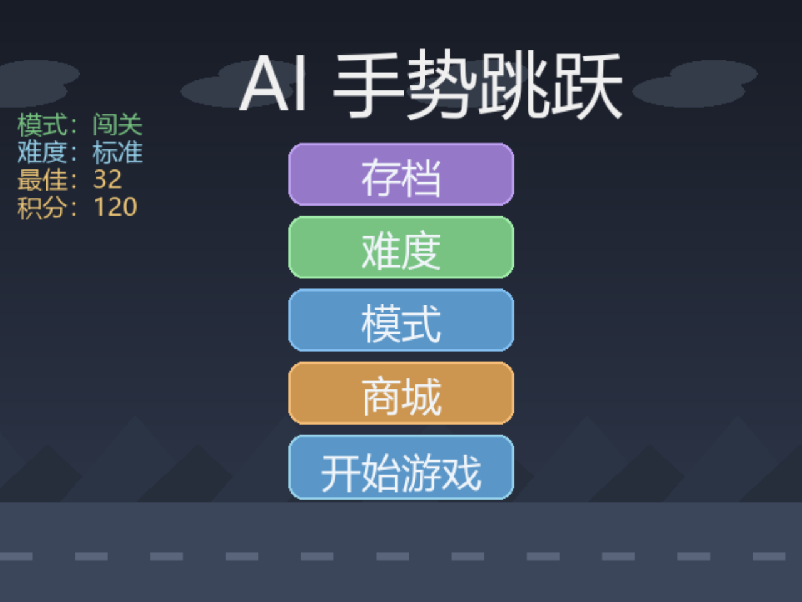
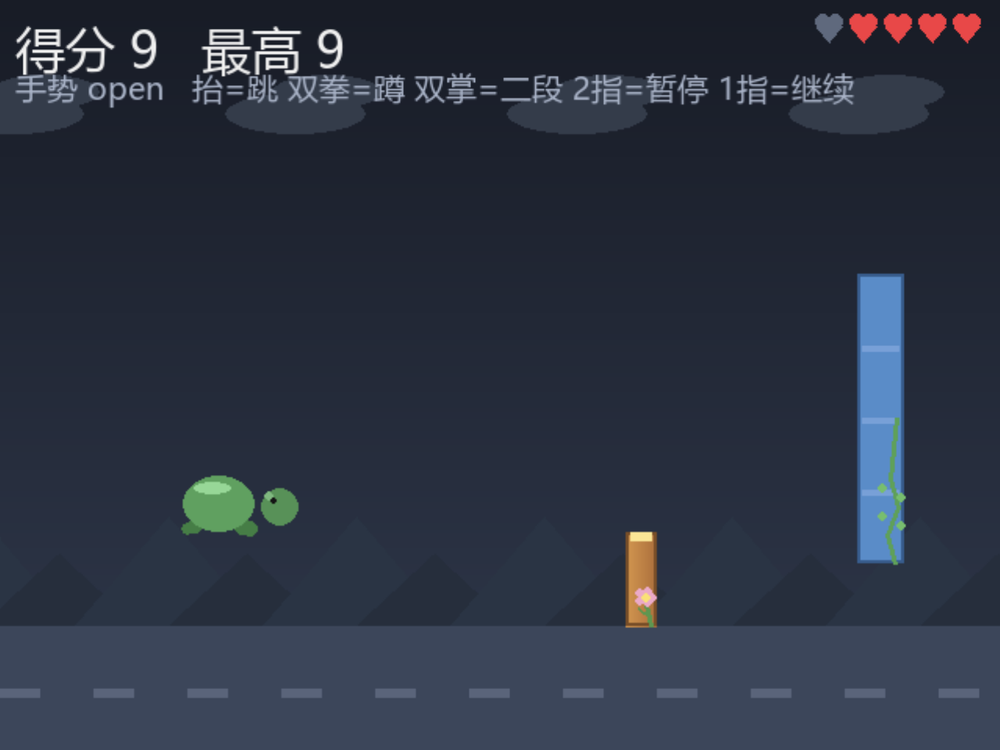

# AI Gesture Jump

> A 2D side-scrolling platformer controlled entirely by **hand gestures** in front of a webcam — no keyboard, no mouse.

Built with **Python 3.12 · MediaPipe Hand Landmarker (21 landmarks, no training) · OpenCV · Pygame 2.6**.

Repos: [Gitee (primary)](https://gitee.com/rainprayer/ai-gesture-game) | [GitHub (mirror)](https://github.com/rain-prayer/ai-gesture-game)

| Main menu | In-game |
|:--:|:--:|
|  |  |

## What it is

A complete little game — one hand-crafted level, 3 game modes, 3 difficulties, 5 lives, 10 save slots, a coin shop with 5 skins, procedurally generated sound effects and music. The interesting part is not the platformer: it is making **noisy, real-world hand tracking** feel like a reliable controller.

## Controls

| Gesture | Action |
|---|---|
| One open palm (≥3 fingers extended) | Jump |
| Both fists | Crouch / stand (toggle) |
| Both palms open (in mid-air) | Double jump |
| Two fingers | Pause |
| One finger | Resume |
| Fist / no hand | Idle (safe fallback) |

Keyboard fallback for machines without a webcam: `↑` / `Space` jump, `↑` in mid-air double jump, `↓` toggle crouch.


## How the tracking is kept stable

1. **Debounce** — a gesture must be stable for 4 consecutive frames;
2. **Edge trigger** — jump fires only on the rising edge, so a held palm does not bunny-hop;
3. **Hysteresis** — crouch enters after 2 frames and re-arms after 8;
4. **Graceful degradation** — lost hand / bad lighting falls back to `idle` instead of random input.

Finger classification uses pure geometry: a finger counts as extended when `dist(tip, wrist) > dist(pip, wrist)`. `≥3` extended → open, `0` → fist. Inference runs in a background thread (~9 ms per 640×480 frame), decoupled from the 60 FPS render loop.

## Quick start

```bash
git clone https://gitee.com/rainprayer/ai-gesture-game.git
cd ai-gesture-game
python -m venv .venv && source .venv/bin/activate   # Windows: .venv\Scripts\activate
python -m pip install -r requirements.txt
python game/main.py
```

The MediaPipe model is bundled (`game/models/hand_landmarker.task`), so no network download is required after cloning.

Self-test without a camera:

```bash
python tools/smoke_test.py
```

## Project layout

```
game/    main.py · hand_tracking.py · assets/ · models/ · sounds/
tools/   smoke_test.py · bench_latency.py · gen_sounds.py
docs/    ARCHITECTURE.md · GESTURES.md · AI_COLLABORATION.md · PUBLISH.md · images/
```

## Notes & limitations

- Only the first detected hand is used for one-hand gestures (`hands[0]`), so keep using the same hand during a demo;
- 640×480 internal resolution, upscaled to fullscreen — not native HD;
- Fully tested on Windows 11 + Python 3.12; Linux/macOS support exists in code but is not thoroughly tested.

## License

MIT — see [LICENSE](LICENSE). MediaPipe model and dependencies follow their own licenses — see [NOTICE.md](NOTICE.md). No third-party copyrighted character art is included.

中文说明见 [README.md](README.md)。
